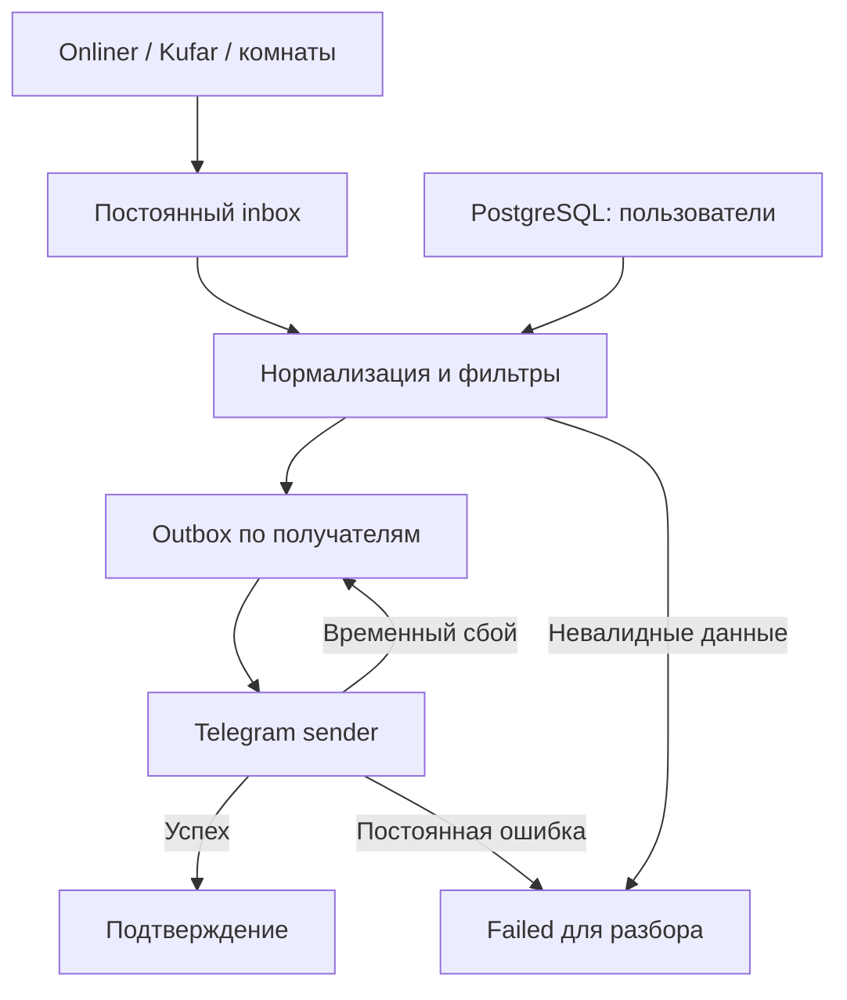

# Аудит flats-bot-2 — 11 ноября 2026

## Объём и границы

Исходная точка: `master`, commit `acbe224`. Просмотрены все 47 отслеживаемых файлов
репозитория: парсеры, рассылка, БД, фильтры, обработчики, клавиатуры, аналитика,
зависимости, схема и документация; изучена история изменений и проверены её
типовые шаблоны Telegram-токенов/URL с паролями. Прочитан весь приложенный errors.log
(4 886 строк), события сгруппированы по началу записи, а не по строкам traceback.

Рабочий VPS, его systemd/cron, PostgreSQL, Redis, настройки proxy и резервные копии
не предоставлялись. Их фактическое состояние, число пользователей, нагрузка,
права файлов, OOM, дисковое пространство и конкретные потерянные сообщения
из этого материала установить нельзя. Ниже разделены факты и выводы.
Исходный лог и реальные секреты в репозиторий не добавлены.

## Что доказано логом

Период записей: **2026-08-28 10:20:32 — 2026-10-23 05:05:15**, в часовом поясе
исходного процесса (лог не содержит timezone). Всего **282 события**:
**227 ERROR, 53 WARNING, 2 INFO**. Traceback содержит промежуточные и итоговые
исключения; складывать их как независимые происшествия нельзя.

| Группа | Событий | Что известно |
|---|---:|---|
| Ошибки Telegram polling | 194 | Получение обновлений периодически не работало; само по себе не доказывает окончательную остановку |
| Ошибки рассылки HTTP | 8 | Все видимые итоговые HTTPError — 400 при sendMediaGroup; описание Telegram не сохранялось |
| Другие ошибки рассылки | 7 | Таймауты/ошибки соединения с proxy, включая отправку фото |
| Сетевые запросы Onliner | 14 | Общий текст без достаточной диагностики |
| Не-200 Onliner | 5 | В сохранённых фрагментах HTML — 502 Bad Gateway |
| Не-200 Kufar квартиры | 9 | Статус явно не записан; нельзя честно классифицировать все ответы |
| Не-200 Kufar комнаты | 12 | Аналогично |
| HTML-поиск имени Onliner | 3 | Ошибка необязательного enrichment |
| Повторы Nominatim | 26 | Таймауты и DNS-сбои внешнего геокодера |
| Необработанная async-задача | 1 | Последнее событие: redis.exceptions.ConnectionError: Connection closed by server |
| Старт/polling/skip updates | 3 | Два INFO и один WARNING |

Среди 194 ошибок polling есть 70 `Bad Gateway`, 43 `Gateway Timeout`, 42
`ServerDisconnectedError` на внешнем уровне aiogram и 6 ошибок соединения с proxy.
Это неполная детализация, а не сумма всех разновидностей. Промежуточный
`ServerDisconnectedError` и оборачивающий его `NetworkError` — одно происшествие.

**Критический факт:** в traceback присутствует полноценный BOT_TOKEN,
а query string части запросов содержит chat ID и содержимое объявления.
Нужна ротация токена через BotFather. Маскирование новых журналов не отзывает старый токен.
Поиск двух типовых шаблонов секретов в Git-истории совпадений не дал; это не
эквивалент полноценному поиску всех возможных типов секретов.

**Нельзя утверждать**, что последняя Redis-ошибка остановила весь бот, что VPS
перезагружался или что все ошибки polling привели к потерям. В логе нет heartbeat,
exit codes, метрик очереди, идентификаторов успешной доставки и system journal.
Однако потери при ошибках рассылки непосредственно следуют из алгоритма исходного кода.

## Реестр находок и принятые исправления

P0 — секреты/потеря данных, P1 — остановка/существенная ненадёжность,
P2 — качество фильтрации, сопровождение и предсказуемость.

| № | Приоритет | Место исходного кода / дефект | Исправление |
|---|---|---|---|
| 1 | P0 | ad.py: токен в URL traceback; sendPhoto/sendMessage передавали текст в query string | JSON POST, безопасные ошибки, маскирование message и полного traceback; токен должен перевыпустить владелец |
| 2 | P0 | poll_* добавляли ID до save/broadcast | Сначала durable inbox, затем атомарное создание outbox и завершение inbox |
| 3 | P0 | send_* глотали ошибку, broadcast считался завершённым | ACK отдельно на каждого получателя только после успешного ответа API |
| 4 | P0 | Весь прогресс — deque в RAM; рестарт забывает историю | SQLite inbox/outbox с уникальными ключами source/id/chat и WAL |
| 5 | P1 | При неудачной инициализации пустая deque могла не удерживать ID | Инициализация отмечается только после корректной непустой выдачи и транзакции |
| 6 | P1 | init_* сетевые вызовы вне защищённого цикла | Инициализация проходит в том же восстанавливаемом worker-цикле |
| 7 | P1 | requests.get без timeout в источниках и HTML | Ограниченные сетевые операции, ограничение ответа 8 MiB, supervisor зависших workers |
| 8 | P1 | Один bad ad прерывает весь batch | Исходный JSON сначала сохранён; bad ad получает failed, остальные продолжаются |
| 9 | P1 | Поток мог умереть, join остальных оставлял живой процесс | Heartbeat/контроль потоков, критический сигнал, exit для systemd Restart=always |
| 10 | P1 | Обработка рассылки блокирует чтение источника | Три независимых feed-workers, отдельно нормализация/подбор и один sender |
| 11 | P1 | Всего 15 последних объявлений Kufar, без pagination | 100 на страницу, догрузка страниц до известной выдачи, cursor сохраняется при MAX_PAGES и продолжает работу следующим циклом |
| 12 | P1 | Частично успешная догрузка могла бы скрыть недочитанный хвост | Все страницы одного ограниченного цикла фиксируются вместе; ошибка запроса не коммитит частичный скан |
| 13 | P1 | Рекурсивный retry 429 каждую секунду | Нерекурсивная дисковая очередь, retry_after, общий cooldown sender |
| 14 | P1 | В рекурсивном sendPhoto/sendMediaGroup терялся caption | Полный payload хранится до подтверждения; повтор использует исходные данные |
| 15 | P1 | Ошибки фото могли навсегда лишить пользователя объявления | При явном 400 медиа — fallback к тексту со ссылкой; сетевой таймаут не запускает немедленный второй формат |
| 16 | P1 | 403/недоступный получатель создавали бесконечные ошибки | Получатель деактивируется, элемент blocked; ошибка остальных не затрагивает |
| 17 | P1 | HTTP status принимался за успех без проверки API body | Проверяются `ok`, error_code, description и parameters |
| 18 | P1 | Неограниченный/несогласованный темп трёх sender-потоков | Один sender, до 10 медиа/сообщений в секунду, per-chat cooldown; 429 остаётся окончательным сигналом сервера |
| 19 | P1 | Два parser/bot экземпляра могут дублировать работу | Раздельные Linux flock-блокировки на постоянном DATA_DIR; рассчитано на один VPS |
| 20 | P1 | db.py собирал SQL f-строками, JSON с апострофом ломает запрос | Параметризованный SQL; имена SQL-полей в queue-коде только из внутренних whitelist |
| 21 | P1 | check→insert неатомарен, users.id_tg не UNIQUE | UNIQUE-индекс и INSERT ON CONFLICT; миграция не удаляет дубликаты молча |
| 22 | P1 | __exit__ всегда commit, закрытие при ошибке commit ненадёжно | rollback при исключении, cursor/connection закрываются в finally |
| 23 | P1 | read-modify-write params разными соединениями теряет параллельные изменения | Одна транзакция и SELECT FOR UPDATE; события одного FSM дополнительно изолированы |
| 24 | P1 | Синхронный PostgreSQL/георасчёт в async-handler блокирует loop | DB/генерация клавиатур/аналитика вынесены в asyncio.to_thread; connect/query/lock timeout |
| 25 | P1 | Redis — отдельная точка отказа, последний traceback связан с ним | SQLite FSM; PostgreSQL-пользователи сохранены; незавершённые старые Redis-диалоги не мигрируются |
| 26 | P1 | skip_updates=True удалял накопившиеся команды | Новая версия не сбрасывает pending updates при запуске |
| 27 | P1 | Старые framework/dependency pins | aiogram 3, новый lock; проверка прежнего aiohttp 3.8.6 дала 88 advisory records, новый lock — 0 известных на момент проверки |
| 28 | P1 | Нет критических сигналов/контроля длительного сбоя | Дисковая очередь alert-сообщений, throttle по типу, независимый маршрут, проверки polling/БД/очередей/диска |
| 29 | P2 | `str(os.environ.get(...))` превращал отсутствие proxy в 'None' | Явные optional proxy и required token/admin, три независимых маршрута |
| 30 | P2 | ROOT_PATH, cwd и bare imports ломали запуск | Package imports и запуск python -m; пути относительно конфигурации/проекта |
| 31 | P2 | Имя автора искалось отдельным HTML GET с хрупким CSS-селектором | Запрос удалён; Onliner author='Не указано', основной результат не зависит от необязательного поля |
| 32 | P2 | Внешний Nominatim на каждое объявление: latency/DNS/rate limits/неполный catch | Город из address/user_address, без стороннего геокодера; неоднозначные данные сохраняются failed |
| 33 | P2 | response[:100] и kufar_ads[:100] при None сами вызывали исключение | Структурная проверка JSON; нет обращения к Response как к списку |
| 34 | P2 | None/NaN/нечисловая цена, None coordinates, нет images | Проверки модели, Decimal minor units Kufar, безопасные отсутствующие фото/геоданные |
| 35 | P2 | `rent_type[0]` обрезал число комнат до одной цифры | Полный числовой префикс, отдельный тип комнаты |
| 36 | P2 | HTML автора/города/ссылки без escaping | Escaping внешних полей, разрешённые HTTPS listing-hosts, fallback длинного caption в текст |
| 37 | P2 | Фильтры источника в params не использовались, source handler закомментирован | Фильтр применяется; /sources с сохранением предыдущего FSM-состояния |
| 38 | P2 | Изменение фильтров происходило при активной подписке | /start и «Изменить» приостанавливают рассылку до завершения; перед доставкой фильтры перепроверяются |
| 39 | P2 | Можно закончить настройку без комнат/станций; непроверенный callback | Проверка выбора/диапазонов, keyboard строится из БД после сохранения |
| 40 | P2 | Названия Минск/Minsk и Могилёв/Могилев не совпадали | Общая нормализация town; учтён user_address и сельсовет перед населённым пунктом |
| 41 | P2 | Парк Челюскинцев имел координаты Академии наук; 33 станции устарели | Исправлена явная копия; добавлены Аэродромная, Неморшанский сад, Слуцкий гостинец в конец списка без смены старых ID |
| 42 | P2 | Клавиатура метро жёстко ограничена 33 станциями | Генерируется по длине списка; прежние indices не переупорядочены |
| 43 | P2 | Общий errors.log двух процессов без ротации | Раздельные rotating logs + journald, текущие файлы доступны ADMIN_ID |
| 44 | P2 | ads.csv без заголовка, pandas ожидал named columns; DataFrame передавался как text | Статистика стандартной библиотекой по очереди, явная область данных; JSONL экспорт inbox |
| 45 | P2 | pandas/numpy/bs4/requests/transliterate и pinned transitives без нужды | Три прямые runtime-зависимости; stdlib HTTP/CSV/SQLite/statistics, reproducible lock |
| 46 | P2 | Нет тестов, эксплуатационных инструкций, стратегии восстановления | unittest fault tests, offline FSM flow, PostgreSQL integration tests для CI, unit-файлы и runbook |

## Устройство после исправлений

Одна машина, один parser-процесс и один bot-процесс. SQLite не предназначен здесь
для сетевой FS или нескольких replicas. PostgreSQL оставлен, чтобы не рисковать
миграцией пользовательских данных ради уменьшения числа сервисов. Geopy оставлен
для геодезических расстояний: сам по себе расчёт не обращается в интернет.
Убранные Redis/Nominatim/HTML parsing дают больше пользы, чем переписывание
проверенного расчёта расстояний или Telegram framework вручную.

## Проверка и её пределы

- Локальные unit/fault tests: очередь после рестарта, rollback enqueue, изоляция
  bad ad/user, bootstrap, pagination и незавершённый scan, API 400/403/429/401,
  таймаут без ACK, unsubscribe, HTML escaping, currency/coordinates, FSM persistence,
  SQL-параметры и rollback connection.
- Offline aiogram flow: /start → town → price → rooms → landlord → metro/no →
  point/no → active → pause → resume → change; админ-команда недоступна обычному user.
- PostgreSQL integration tests запускаются при TEST_POSTGRES_DSN; CI поднимает
  PostgreSQL 17 и проверяет конкурентную регистрацию/изменения и rollback.
  В локальной среде сервера PostgreSQL не было: эти тесты пропускаются, мок-тест
  соединения нельзя выдавать за проверку настоящей БД.
- Живые read-only ответы: 36 объявлений Onliner, 100 квартир и 100 комнат Kufar;
  parser разобрал выборки. Kufar next token действительно открыл страницу 2.
  Разовый 406 выявил лишний Content-Type у GET; после исправления запрос Onliner
  прошёл. Это наблюдение, а не гарантия, что площадки не изменят формат/доступ.
- Установка точного lock в Python 3.11, compileall, статический поиск undefined names,
  dependency audit. Нулевой advisory count не является доказательством отсутствия
  всех уязвимостей и требует повторения при обновлениях.
- Реальные сообщения пользователям не отправлялись; credentials из лога не использовались.
  Поведение рабочей VPS/proxy/PG и пользовательская приёмка остаются этапом развёртывания.

Актуальные результаты команд и CI следует смотреть в PR: они относятся к конкретному
commit, а не к обещанию бессрочной совместимости.

## Ограничения, которые нельзя скрывать

1. **Не exactly-once.** Telegram мог принять сообщение, а ответ потерялся; между
   успешной отправкой и локальным ACK процесс тоже может упасть. Повтор возможен.
   Без idempotency key со стороны Telegram устранить оба случая невозможно.
2. **Не архив всего рынка.** Объявление может исчезнуть до опроса или за время
   простоя. Cursor догружает доступную выдачу, но не восстанавливает удалённые записи;
   порядок выдачи может изменяться. Первый успешный запуск сознательно не рассылает
   уже имеющуюся первую страницу. Одно и то же ID после поднятия не считается новым.
3. **Внешние сервисы могут быть недоступны долго.** Очередь сохраняет работу,
   но не делает недоступный Telegram/Onliner/Kufar доступным. Во время долгого простоя
   могут накопиться устаревшие квартиры: автоматического удаления pending по TTL нет.
4. **Нет резервирования VPS.** systemd перезапустит процессы после завершения,
   но не исправит повреждённый диск/ОС, отсутствие интернета или выключенную машину.
   Нужны off-host backup и внешний контроль, выбранные владельцем инфраструктуры.
5. **Фильтры географии приблизительны.** Метро — центр станции, расстояние по геодезической
   прямой, не пеший маршрут до входа. Адресные поля и district/area Kufar не всегда
   описывают населённый пункт одинаково. Остальные старые координаты не подвергались
   геодезической верификации всех входов. Все новые станции добавлены в конец.
6. **Состояние диалога и PostgreSQL — разные хранилища.** Нет распределённой транзакции.
   При сбое между сохранением фильтра и сменой шага может потребоваться повтор ввода
   или /start; подписка выключена на время редактирования. Это осознанный компромисс
   простой архитектуры, а не утверждение об атомарности всего диалога.
7. **Ручная broadcast не перезапускаемая кампания.** Имеет pacing/retry/отчёт, но
   прогресс кампании не переживает падение. Постоянная доставка реализована для квартир.
8. **Масштаб ограничен одним sender и запросами к PG.** Для текущего небольшого бота
   это простая контролируемая схема. Реальный размер аудитории неизвестен; рост
   pending старше 30 минут сигнализирует, что необходим замер пропускной способности.
9. **Требуется действие владельца:** ротация токена, выбор ADMIN_ID/маршрута alert,
   backup, миграция UNIQUE и приёмка на VPS. Эти действия не были выполнены удалённо.

## Источники для API и справочников

- [Telegram Bot API](https://core.telegram.org/bots/api): media group, caption,
  ResponseParameters.retry_after, формат ошибок.
- [Миграция aiogram 2 → 3](https://docs.aiogram.dev/en/latest/migration_2_to_3.html).
- [aiogram AiohttpSession и proxy](https://docs.aiogram.dev/en/latest/api/session/aiohttp.html).
- [Парк Челюскинцев, координаты](https://www.wikidata.org/wiki/Q2625698).
- [Аэродромная](https://www.wikidata.org/wiki/Q13032782),
  [Неморшанский сад](https://www.wikidata.org/wiki/Q4317004),
  [Слуцкий гостинец](https://en.wikipedia.org/wiki/Slutski_Hastsinets).

Новые координаты — справочные точки станций. У runtime нет зависимости от этих сайтов.
